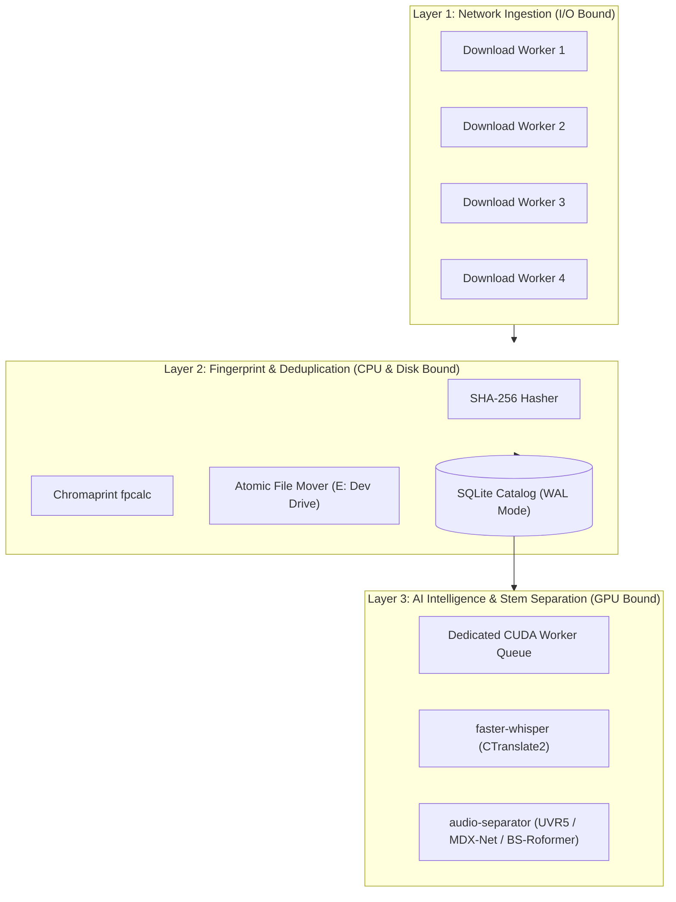

# Parallel Processing Architecture & Concurrency Guide

This document specifies the concurrent and parallel computing model implemented in **Sound Experiments** (`soundlab`). Any subsequent agent, developer, or automated pipeline must adhere to these design principles to ensure maximum throughput without crashing system resources.

---

## 1. Hardware Concurrency Mapping

The pipeline is tuned specifically for the probed laptop hardware profile:
- **CPU (Intel Core i7-13700H):** 14 Physical Cores (6 Performance Cores + 8 Efficient Cores), 20 Hardware Threads.
- **RAM (16 GB DDR5-5600):** Operating headroom requires leaving at least **2.0 GB** for Windows system stability. Never load full uncompressed audio catalogs into memory.
- **GPU (NVIDIA RTX 4060 Laptop):** 8188 MiB VRAM (CC 8.9), CUDA 12.4. Max VRAM ceiling for ML models is capped at **7000 MiB**.
- **I/O Storage:** Primary `E:\` is a high-speed ReFS Dev Drive (~580 MB/s sequential write). Overflow `D:\` is a fast NVMe (~755 MB/s).

---

## 2. Decoupled Pipeline Architecture (Producer-Consumer)

The pipeline is split into three decoupled concurrency layers:

---

## 3. Concurrency Layer Rules

### Layer 1: Network Ingestion (Parallel ThreadPool)
- **Concurrency:** `4` parallel worker threads (configurable via `--workers` or `-w`).
- **Rationale:** Prevents network stalls from single-stream bottlenecks while remaining polite to prevent platform IP rate-limiting.
- **Isolation:** Each worker downloads to an isolated temporary file in `D:\SoundExperiments\derived\tmp_downloads\`.

### Layer 2: Fingerprinting & Cataloging (Thread-Safe Multi-Core)
- **Chromaprint & Checksums:** Computed in parallel per worker immediately upon stream completion.
- **Database Thread Safety:** Every thread instantiates its own SQLite connection.
  - `PRAGMA journal_mode = WAL;` enables concurrent readers alongside a concurrent writer.
  - `PRAGMA busy_timeout = 30000;` ensures threads wait up to 30 seconds for lock release during concurrent commits without failing.
- **Atomic Storage:** Files are written to `.tmp` files before being atomically renamed/moved to `E:\Sound Experiments\Kobe bryant Database raw\sources\<platform>\<id>\audio.<ext>`.

### Layer 3: GPU Acceleration (Single-Stream Dedicated CUDA)
- **Rule:** Never spawn parallel CUDA inferences on an 8 GB laptop GPU. Running multiple PyTorch or ONNX GPU processes concurrently causes Out-Of-Memory (OOM) errors and crashes the display driver.
- **Architecture:** All GPU operations (Whisper transcription, UVR5 vocal separation, and RVC model inferences) run sequentially through a single dedicated worker queue with `float16` precision and explicit memory cleanup (`torch.cuda.empty_cache()`).

---

## 4. State Tracking & Crash Resilience

1. **Idempotence:** Every URL and file checksum is indexed in `catalog.sqlite`. Re-running the harvester over previously queried videos skips already-processed records in milliseconds.
2. **Resumable Downloads:** If interrupted, temporary `.part` downloads are resumed by `yt-dlp`.
3. **Quarantine Safety:** Duplicates detected during parallel execution are atomically moved to `_quarantine/duplicates/dup_of_<id>/` and logged in the database. Raw data is **never** deleted.
4. **Zero-Duplicate Mathematical Verification:** At any stage, running `soundlab verify-dedup` runs an exhaustive $O(N)$ hash audit and $O(N^2)$ acoustic matrix check to prove zero duplicates exist in the active set.
