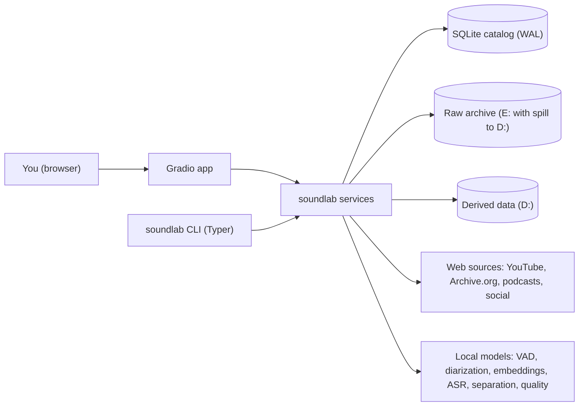
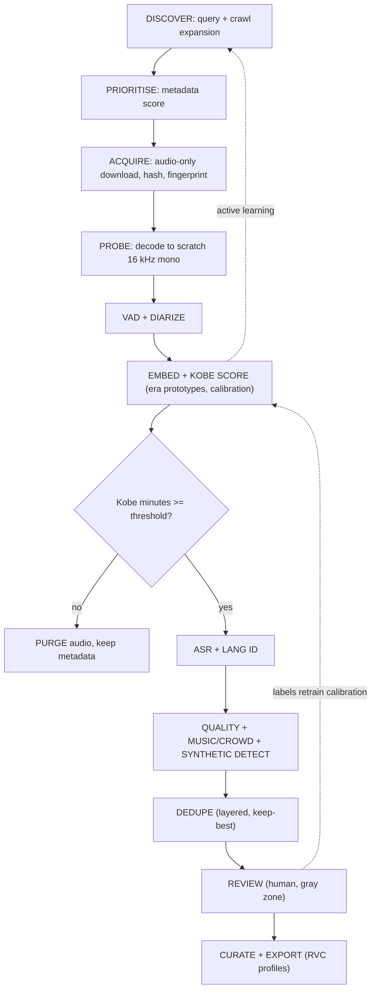
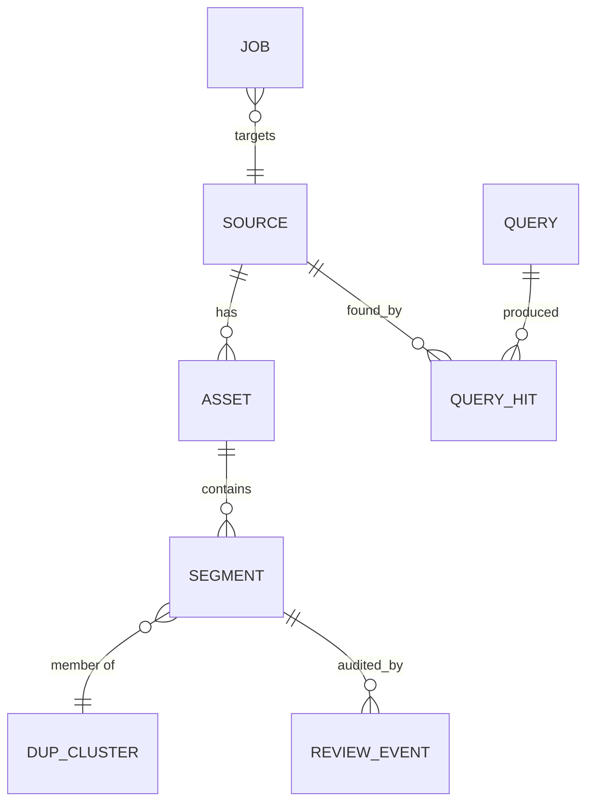

# Software Design Document - Sound Experiments / Kobe Voice Dataset

Version 1 (draft) | Companion to [`IMPLEMENTATION_PLAN.md`](IMPLEMENTATION_PLAN.md) and [`SYSTEM_SPECS.md`](SYSTEM_SPECS.md)

> Hardware-sensitive numbers (batch sizes, VRAM budgets, worker counts) are **not** hard-coded here.
> They come from `configs/hardware_profile.yaml`, generated by `tools/system_probe.py`.
> Any model tuning this system for the laptop should edit that file, not the code.

---

## 1. Goals and non-goals

**Goals**
- G1. Discover, acquire and *verify* every obtainable recording of one target speaker (Kobe Bryant).
- G2. Keep raw files immutable; keep every decision explainable and reversible.
- G3. Guarantee (and prove) there are no duplicate recordings in the canonical set.
- G4. Provide a web UI for operating the pipeline and human review of uncertain cases.
- G5. Produce RVC-ready training exports with measurable quality gates.
- G6. Be a reusable foundation (`soundlab`) for later audio projects.

**Non-goals (for this project)**
- Training or running RVC itself (Project 02), singing/auto-tune app, music generation.
- Real-time processing. Throughput matters; latency does not.

## 2. System context



## 3. Pipeline architecture

Every stage is **idempotent**, **resumable**, and communicates only through the catalog.



### 3.1 Stage contracts

| Stage | Input | Output (catalog) | Idempotency key | Resource |
|---|---|---|---|---|
| discover | query / seed | `source` rows (status `candidate`) | (platform, platform_id) | network |
| prioritise | `source` | `source.prior_score` | source_id | CPU |
| acquire | `candidate` | `asset` row + file on disk | source_id + format_id | network, disk |
| probe | `asset` | scratch wav path, loudness | asset_id + probe_version | CPU/disk |
| vad_diarize | scratch wav | `segment` rows with speaker cluster | asset_id + model_version | GPU |
| embed_score | segments | `segment.kobe_score`, `era` | segment_id + model_version | GPU |
| triage | scores | keep / purge decision, file removal | asset_id | disk |
| asr | kept segments | transcript, language | segment_id + model_version | GPU |
| quality | kept segments | score card columns | segment_id + metric_version | GPU/CPU |
| dedupe | kept segments | `dup_cluster`, `is_canonical` | corpus snapshot id | CPU/RAM |
| review | gray-zone segments | `review_event` + status | segment_id | human |
| export | canonical accepted | dataset on `D:` + dataset card | profile + snapshot id | CPU/disk |

A stage is skipped when a row with the same key and the same **model/metric version** already exists.
Bumping a version re-runs only what depends on it.

## 4. Repository layout

```text
E:\Sound Experiments\
|- README.md
|- pyproject.toml                 workspace (uv), ruff, pytest config
|- docs\                          IMPLEMENTATION_PLAN, SOFTWARE_DESIGN, SYSTEM_SPECS(.json)
|- configs\                       hardware_profile.yaml (generated), pipeline.yaml, queries\*.yaml, export_profiles\*.yaml
|- tools\                         system_probe.py, bootstrap scripts
|- src\soundlab\                  REUSABLE core
|    |- config.py  logging.py  storage.py  db\ (models, migrations)  jobs.py  resources.py
|    |- audio\   io.py  resample.py  loudness.py  slicing.py
|    |- net\     ytdlp_adapter.py  archive_org.py  rss.py  throttle.py
|    |- models\  vad.py  diarize.py  speaker_embed.py  asr.py  separation.py  enhance.py
|    |             music_tagger.py  quality_mos.py  synth_detect.py  langid.py
|    |- dedupe\  exact.py  chroma.py  landmark.py  transcript_hash.py  embed_index.py  policy.py  benchmark.py
|    \- export\   rvc.py  dataset_card.py
|- projects\
|    \- kobe_dataset\             discovery strategies, query templates, enrollment, review logic, CLI
|- apps\
|    \- lab_ui\                   Gradio app (tabs as modules)
|- tests\                         unit + integration + fixture archive
\- Kobe bryant Database raw\      DATA (git-ignored)  sources\ _catalog\ _manifests\ _quarantine\ inbox\
```

`projects/*` may import `soundlab`; `soundlab` never imports from `projects` or `apps`.

## 5. Data model (SQLite, WAL mode)



Key tables (abridged DDL, names final, types SQLite-native):

```sql
CREATE TABLE source (
  source_id INTEGER PRIMARY KEY, platform TEXT NOT NULL, platform_id TEXT NOT NULL,
  url TEXT, title TEXT, uploader TEXT, upload_date TEXT, duration_s REAL, language_hint TEXT,
  prior_score REAL, status TEXT NOT NULL,         -- candidate|downloaded|verified|purged|rejected|error
  kobe_minutes REAL, discovered_via TEXT, created_at TEXT,
  UNIQUE(platform, platform_id));

CREATE TABLE asset (
  asset_id INTEGER PRIMARY KEY, source_id INTEGER REFERENCES source,
  path TEXT NOT NULL, tier TEXT NOT NULL,         -- 'E' | 'D_overflow' | 'inbox'
  codec TEXT, bitrate_kbps INTEGER, sample_rate INTEGER, channels INTEGER, bytes INTEGER,
  sha256 TEXT NOT NULL UNIQUE, chromaprint TEXT, downloaded_at TEXT);

CREATE TABLE segment (
  segment_id INTEGER PRIMARY KEY, asset_id INTEGER REFERENCES asset,
  start_s REAL, end_s REAL, speaker_cluster TEXT,
  kobe_score REAL, kobe_prob REAL, era TEXT, language TEXT, transcript TEXT,
  dnsmos_ovrl REAL, snr_db REAL, bandwidth_hz REAL, music_prob REAL, crowd_prob REAL,
  reverb_score REAL, clip_ratio REAL, lufs REAL, synthetic_prob REAL,
  decision TEXT,                                  -- auto_accept|needs_review|auto_reject|human_accept|human_reject
  dup_cluster_id INTEGER, is_canonical INTEGER DEFAULT 0, quality_rank REAL,
  model_versions TEXT);                           -- JSON: which model/version produced each field

CREATE TABLE dup_cluster (cluster_id INTEGER PRIMARY KEY, method TEXT, confidence REAL, canonical_segment_id INTEGER);
CREATE TABLE review_event (id INTEGER PRIMARY KEY, segment_id INTEGER, reviewer TEXT, label TEXT, note TEXT, at TEXT);
CREATE TABLE query (query_id INTEGER PRIMARY KEY, text TEXT, platform TEXT, family TEXT, run_at TEXT, hits INTEGER, new_candidates INTEGER, kobe_minutes_yield REAL);
CREATE TABLE query_hit (query_id INTEGER, source_id INTEGER, rank INTEGER);
CREATE TABLE job (job_id INTEGER PRIMARY KEY, stage TEXT, target_id INTEGER, status TEXT, attempts INTEGER, error TEXT, started_at TEXT, finished_at TEXT);
```

Rules: no row is hard-deleted; raw files are never rewritten; every automatic decision stores the
scores and model versions that produced it, so it can be re-derived or audited.

## 6. Module designs

### 6.1 Discovery (`projects/kobe_dataset/discovery`)
- **Strategies** (independent on purpose, for capture-recapture coverage estimation):
  S1 query matrix (templates x years x events x interviewers x languages), S2 channel/playlist crawl from
  verified positives, S3 podcast RSS + Internet Archive + Wikimedia Commons, S4 filmography / event seed lists,
  S5 local `inbox/` imports.
- **Why date slicing:** a single search query is depth-capped; slicing by year/month and by facet surfaces the long tail.
- **Priority score** = f(title/description keywords, duration band, uploader reputation, language, recency of
  yield from the same query family). Highlight reels / music mixes score low but are not excluded outright.
- **Coverage estimate:** with two independent strategies A and B finding sets of verified sources,
  Lincoln-Petersen estimate N ~ |A| * |B| / |A intersect B| (reported with a confidence band; caveats documented).

### 6.2 Acquisition (`soundlab/net`)
- `yt-dlp` as a library: `bestaudio`, keep original container/codec, `--download-archive`, retries with
  exponential backoff + jitter, per-host concurrency and sleep limits, browser cookies (opt-in).
- JS challenge solving uses an external runtime (Deno and Node are already installed).
- After download: SHA-256, `ffprobe` metadata, Chromaprint fingerprint, then atomic move into place
  (`.part` -> final) so a crash can never leave a half file in the archive.
- Storage manager picks tier by free-space rules; the catalog stores the real path.

### 6.3 Speaker verification (`soundlab/models` + `projects/kobe_dataset/enrollment`)
1. **VAD** (Silero VAD) -> speech regions.
2. **Diarization** (`sherpa-onnx` offline diarization: ONNX segmentation + speaker embeddings; fallback: sliding-window
   ECAPA embeddings + agglomerative clustering) -> speaker clusters per asset; overlap regions flagged and excluded.
   Both paths are ungated (no tokens). They are compared on the pilot and the better one becomes default.
3. **Embeddings:** ensemble of two or more speaker models (e.g. ECAPA-TDNN + WeSpeaker/TitaNet).
   Scores are z-normalised against a **cohort** (AS-norm) built from non-Kobe speakers harvested from the same corpus.
4. **Enrollment:** you confirm ~20 clips by ear -> multi-prototype per **era**
   (1996-99, 2000-07, 2008-15, 2016-20). Era comes from recording date metadata, falling back to a classifier.
5. **Decision:** logistic calibration maps fused score -> probability. Two thresholds:
   `p >= tau_high` auto-accept, `p <= tau_low` auto-reject, otherwise `needs_review`.
   Thresholds are chosen on labelled data to hit a precision target, not guessed.
6. **Hard negatives:** every rejected/other speaker joins the cohort (interviewers, teammates, impersonators),
   so the system gets harder to fool over time.
7. **Cluster-level voting:** a diarization cluster's decision is the aggregate of its segments, so one noisy
   segment cannot flip a whole speaker, and one bad cluster cannot contaminate a source.

### 6.4 ASR and language (`soundlab/models/asr.py`)
faster-whisper large-v3 (int8_float16 on 8 GB), word timestamps, language ID. Transcripts feed content-level dedup,
search, and filtering (e.g. exclude spans where Kobe is clearly quoting or reading a script, if desired).

### 6.5 Separation and enhancement (`separation.py`, `enhance.py`)
- Candidates: RoFormer-family vocal separators and Demucs v4 via `audio-separator`; DeepFilterNet-class denoisers;
  de-reverb models.
- **Policy:** only for sources flagged "music bed" or "crowd"; always non-destructive (outputs go to `D:\derived`);
  an automatic A/B metric (DNSMOS, speaker-embedding drift vs. the clean prototype) decides whether the processed
  version replaces the original in an export profile. Embedding drift guards against processing that changes timbre.

### 6.6 Quality and authenticity (`quality_mos.py`, `music_tagger.py`, `synth_detect.py`)
- Metrics: DNSMOS, NISQA/UTMOS, WADA-SNR, effective bandwidth (low-pass cutoff detection), clipping ratio, LUFS,
  reverb estimate, music/crowd/applause tags (PANNs-class tagger).
- **Synthetic-speech detector** (AASIST-family) rejects AI-generated "Kobe" audio. Calibrated on known-synthetic
  clips you approve in the UI; its false-positive rate on verified real audio is tracked as a KPI.
- Output is a **score card** per segment; export profiles are just filters over the score card.

### 6.7 De-duplication (`soundlab/dedupe`) - the guarantee

| Layer | Detects | Method | Notes |
|---|---|---|---|
| L0 | identical bytes / same platform ID | SHA-256, unique index | Free, prevents re-download |
| L1 | re-encode / container change | Chromaprint fingerprint compare | Robust to codec & bitrate |
| L2 | clips, trims, overlaps | landmark (Shazam-style) hashing over speech segments, offset-histogram voting | Finds shared spans with time offsets |
| L3 | music beds, different mixes, different rips of one event | transcript shingles -> MinHash/LSH (and SimHash) over aligned word windows | Content-level, language-aware |
| L4 | speed/pitch shifted copies, residual near-dups | speaker/utterance embeddings in a FAISS index, mutual-nearest + temporal consistency check | Catches what L1-L3 miss; strict thresholds to avoid false merges |

**Policy (`policy.py`):** within a duplicate cluster pick the canonical member by quality rank
(DNSMOS, bandwidth, SNR, absence of music/crowd, source provenance). Others are moved to
`_quarantine/duplicates/` and linked to the canonical row with the layer and score that matched.
**Nothing is deleted.** Merges require agreement thresholds per layer; lone L4 matches go to review.

**Proof tooling:**
- `benchmark.py` creates ground-truth duplicates from your own clips (re-encode, trim, +/-3 % speed, noise/music overlay,
  gain change, different resampling) plus *hard negatives* (different utterances by the same speaker) and reports
  precision/recall per layer and combined. Thresholds live in config and are tuned on this report.
- `soundlab dedupe verify` recomputes all layers over every non-quarantined segment and exits non-zero if any pair
  exceeds the merge thresholds. It runs after each batch and in CI on a fixture archive.

### 6.8 Review (`apps/lab_ui`)
Prioritised queue: segments nearest the decision boundary first (maximum information per minute of your time).
Keyboard-driven: accept / reject / "not Kobe: other speaker" / "synthetic" / "music" / skip. Shows waveform,
spectrogram, transcript with the current word highlighted, source link, era, scores, and nearest known
positives/negatives for context. Every action is an append-only `review_event`.

### 6.9 Export (`soundlab/export/rvc.py`)
Profile (YAML) defines: sample rate, mono, bit depth, slice length range, silence trimming, normalization,
quality gates, era/language balance, exclusion tags, validation split **by source** (no leakage).
Outputs a folder of WAV slices + `manifest.csv` + `DATASET_CARD.md` (hours, distributions, known issues).

## 7. Resource management (`soundlab/resources.py`)

- **GPU lock:** a cross-process lock ensures exactly one heavy model is resident; models are loaded lazily and
  released (`del`, `torch.cuda.empty_cache()`) between stages. Budget from `hardware_profile.yaml`.
- **RAM guard:** before loading a model or a chunk, check `available_ram`; budget = min(ceiling, available - 2 GB).
  Long audio is processed in `audio_chunk_minutes` windows with overlap-stitching.
- **Disk guard:** every write path goes through the storage manager (free-space floor, tier selection, atomic writes).
- **Thermal/power guard:** warn if on battery or on a non-performance power plan; optional cool-down between GPU-heavy batches.
- **Scheduler:** CPU-bound work (fingerprints, hashing, ffmpeg) fans out to `cpu_workers`; network work to `io_workers`
  with per-host throttles; GPU work is a single serial lane fed by a prefetch queue.

## 8. Configuration

Layered YAML + environment, validated by Pydantic v2:
`defaults.yaml` < `hardware_profile.yaml` (generated) < `pipeline.yaml` (yours) < env vars (`SOUNDLAB_*`).
Secrets (HF token, cookies path) only via env or an untracked `.env`.

## 9. Reliability and observability

- Atomic file writes, WAL SQLite, retries with backoff and a **dead-letter** state after N attempts.
- Error taxonomy: `transient_network`, `rate_limited`, `unavailable`, `decode_error`, `model_error`, `disk_full`.
  Only transient classes auto-retry.
- Structured logs (JSON lines) + Rich console; per-stage metrics (throughput, GPU util, VRAM peak) stored in the catalog.
- Daily JSONL manifest export + checksum file to `_manifests/` and a backup copy on `D:`.

## 10. UI design (Gradio Blocks)

| Tab | Purpose |
|---|---|
| Dashboard | hours discovered / downloaded / verified / canonical, disk by tier, queue depth, GPU/RAM gauges, coverage estimate |
| Discover | run query families, view yield per family, add custom queries, import links, drop-in `inbox` status |
| Pipeline | start/stop stages, live job table, retry dead letters |
| Review | the active-learning queue described in 6.8 |
| Duplicates | cluster browser with synchronized A/B playback, why-matched explanation, override canonical |
| Quality | histograms and scatter plots of the score card, click a point to listen |
| Search | transcript full-text (SQLite FTS5) and semantic filters (era, language, tags) |
| Export | choose profile, preview stats, build, open dataset card |
| System | `SYSTEM_SPECS` view, `doctor` checks, config editor |

Binding: `127.0.0.1:7860` by default. LAN exposure and `share=True` are opt-in flags (private data); optional basic auth.

## 11. Testing strategy

- **Unit:** storage tiering, atomic writes, config layering, score calibration math, slicing, dedupe policy.
- **Property tests:** idempotent re-runs produce identical catalogs; killing a stage mid-run never corrupts state.
- **Golden fixtures:** a small benchmark test archive with known duplicates, known speakers
  (TTS voices), music beds - used by dedupe benchmark and the end-to-end smoke test.
- **Model regression:** frozen mini-eval sets for speaker verification (EER/minDCF) and the synthetic detector.
- **Human audit:** a fixed random sample re-reviewed each release; precision/recall tracked in `reports/`.

## 12. Security and privacy

- Data stays local; no uploads. UI is localhost-only by default.
- Credentials via environment only; browser cookies read in-process, never stored in the repo or catalog.
- `.gitignore` excludes data, models, `.env`, cookies, and caches. Manifests contain URLs and hashes, not audio.

## 13. Extensibility to later projects

`soundlab` provides audio I/O, storage tiers, catalog patterns, resource guard, quality metrics and the UI shell.
Planned consumers: `projects/voice_cloning` (RVC training/inference harness and A/B listening tests),
`projects/singing_studio` (F0 extraction, pitch correction, voice conversion, denoise, mastering chain),
`projects/music_gen`. Each adds modules and a UI tab; none fork the core.

## 14. Technology choices

| Concern | Choice | Alternatives considered | Why |
|---|---|---|---|
| Language / env | Python 3.11 in a `uv` venv on `D:` | 3.10 global | Broader wheel support, fast reproducible installs (uv already installed) |
| ML runtime | PyTorch (CUDA build), ONNX Runtime where simpler | TensorFlow | Ecosystem for all chosen models |
| Download | yt-dlp (+ aria2c where useful), `internetarchive`, `feedparser` | custom scrapers | Maintained, huge site coverage |
| VAD / diarization | Silero VAD, sherpa-onnx diarization (fallback: ECAPA sliding-window clustering) | pyannote.audio, NeMo Sortformer | Ungated, Windows-friendly, no tokens (decision D13) |
| Speaker embeddings | SpeechBrain ECAPA + WeSpeaker/TitaNet ensemble | single model | Ensemble + AS-norm reduces error |
| ASR | faster-whisper large-v3 (CTranslate2) | WhisperX, NeMo Parakeet | Fast, fits 8 GB in int8_float16 |
| Separation / enhance | audio-separator (RoFormer/MDX/Demucs), DeepFilterNet | Resemble Enhance | Best-quality open options, evaluated per use |
| Quality | DNSMOS, NISQA/UTMOS, WADA-SNR, PANNs | - | Reference-free, GPU-light |
| Authenticity | AASIST-family detector | - | Anti-spoofing standard |
| Fingerprint / dedup | Chromaprint, landmark hashing, datasketch MinHash, FAISS (CPU) | Dejavu, audfprint | Layered coverage, no single point of failure |
| Storage | SQLite (WAL) + FTS5, Parquet exports | Postgres | Zero-admin, portable, crash-safe |
| CLI / config | Typer, Pydantic v2, Rich | argparse | Typed, ergonomic |
| UI | Gradio Blocks | Streamlit, NiceGUI | Best native audio components |
| Quality gates | ruff, pytest, pre-commit | - | Standard |

Exact versions are pinned in `uv.lock` after the Phase 0 smoke test. If a model fails to run on Windows or 8 GB,
the fallback listed above is used and the substitution is recorded here.
